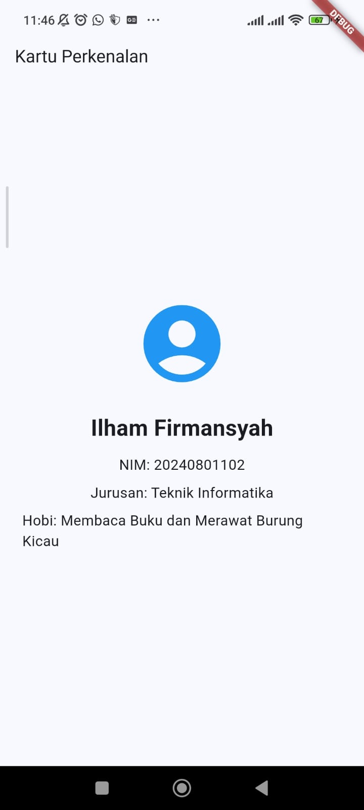

# Tugas Pertemuan 1 — Kartu Perkenalan

## 1. Deskripsi Tugas

Tugas Pertemuan 1 merupakan tugas praktik mata kuliah Pemrograman Mobile yang bertujuan untuk menerapkan konsep dasar Flutter melalui pembuatan aplikasi sederhana bernama **Kartu Perkenalan**.

Aplikasi Kartu Perkenalan menampilkan informasi identitas dalam satu halaman, seperti foto atau ikon profil, nama, Nomor Induk Mahasiswa (NIM), jurusan, dan hobi. Informasi tersebut disusun menggunakan widget dasar Flutter agar tampil terstruktur dan mudah dibaca.

Pembuatan aplikasi ini mengacu pada bagian Tugas dalam Modul Praktikum Flutter Fundamental Pertemuan 1, yang membahas pengenalan Flutter, instalasi, struktur proyek, widget dasar, dan pembuatan aplikasi pertama.

Dalam implementasinya, mahasiswa menerapkan widget `Column`, `Text`, `Icon`, dan `SizedBox` untuk menyusun elemen antarmuka. Melalui tugas ini, mahasiswa juga mempelajari hubungan antarwidget dalam widget tree serta cara menjalankan aplikasi pada emulator atau perangkat Android.

## 2. Tujuan

Tujuan pembuatan aplikasi Kartu Perkenalan adalah:

1. Memahami struktur dasar proyek Flutter.
2. Memahami fungsi `MaterialApp` dan `Scaffold` sebagai struktur utama aplikasi.
3. Menggunakan widget `Column` untuk menyusun informasi secara vertikal.
4. Menggunakan widget `Text` untuk menampilkan informasi identitas.
5. Menggunakan widget `Icon` atau foto sebagai representasi profil.
6. Menggunakan widget `SizedBox` untuk mengatur jarak antarelemen.
7. Memahami penggunaan properti seperti `fontSize`, `color`, dan `mainAxisAlignment`.
8. Menjalankan aplikasi Flutter pada emulator atau perangkat Android.
9. Memahami proses perubahan kode dan penggunaan hot reload.
10. Mendokumentasikan hasil implementasi dalam bentuk screenshot dan kode program.

## 3. Ketentuan Tugas

Berdasarkan Modul Praktikum Flutter Fundamental Pertemuan 1, aplikasi Kartu Perkenalan dibuat dalam satu halaman dan menampilkan informasi berikut:

- **Foto atau ikon:** digunakan sebagai identitas visual profil.
- **Nama:** menampilkan nama mahasiswa.
- **NIM:** menampilkan Nomor Induk Mahasiswa.
- **Jurusan:** menampilkan program studi mahasiswa.
- **Hobi:** menampilkan informasi hobi mahasiswa.

Elemen antarmuka disusun menggunakan widget Flutter yang sesuai, seperti `Column`, `Text`, `Icon`, dan `SizedBox`.

Hasil akhir tugas berupa aplikasi yang dapat dijalankan, tangkapan layar aplikasi, serta berkas kode program atau tautan repositori.

## 4. Teknologi yang Digunakan

| Teknologi atau Widget | Fungsi |
|---|---|
| Flutter | Framework untuk mengembangkan antarmuka aplikasi |
| Dart | Bahasa pemrograman yang digunakan Flutter |
| `MaterialApp` | Menentukan konfigurasi dasar aplikasi |
| `Scaffold` | Menyediakan struktur halaman aplikasi |
| `AppBar` | Menampilkan bilah judul halaman jika digunakan |
| `Column` | Menyusun widget secara vertikal |
| `Text` | Menampilkan teks informasi identitas |
| `Icon` | Menampilkan ikon profil |
| `SizedBox` | Memberikan jarak atau menentukan ukuran |
| `Center` | Menempatkan widget di tengah area yang tersedia |

Tidak semua widget pada tabel wajib digunakan sekaligus. Pemilihan widget disesuaikan dengan implementasi aplikasi yang dibuat.

## 5. Struktur Folder

Struktur folder tugas Pertemuan 1 disusun sebagai berikut:

```text
pertemuan-1/
├── doc-tugas/
├── praktikum/
└── tugas/
    ├── README.md
    └── kartu_perkenalan/
        ├── README.md
        ├── lib/
        │   └── main.dart
        ├── screenshots/
        │   └── 01-kartu-perkenalan.png
        ├── pubspec.yaml
        └── ...
```

Keterangan:

1. `tugas/README.md` merupakan dokumentasi umum tugas Pertemuan 1 yang menjelaskan tujuan, ketentuan, teknologi, struktur folder, cara menjalankan, dan hasil pengerjaan.
2. `tugas/kartu_perkenalan/` merupakan folder proyek aplikasi Kartu Perkenalan.
3. `tugas/kartu_perkenalan/README.md` berisi dokumentasi khusus proyek, termasuk penjelasan implementasi kode dan hasil pengujian.
4. `lib/main.dart` berisi kode utama aplikasi.
5. `screenshots/` digunakan untuk menyimpan tangkapan layar hasil aplikasi.
6. `pubspec.yaml` berisi konfigurasi proyek Flutter dan dependensi yang digunakan.

Struktur tersebut memisahkan dokumentasi umum tugas dari dokumentasi teknis aplikasi sehingga informasi lebih mudah dipahami dan dipelihara.

## 6. Cara Menjalankan Aplikasi

### 6.1. Masuk ke Direktori Proyek

Buka terminal VS Code, kemudian masuk ke folder proyek Kartu Perkenalan.

```bash
cd ~/perkuliahan/pemrograman_mobile/pemrograman-mobile/pertemuan-1/tugas/kartu_perkenalan
```

### 6.2. Memeriksa Dependensi

Jalankan perintah berikut untuk memastikan dependensi proyek tersedia.

```bash
flutter pub get
```

### 6.3. Memeriksa Perangkat

Pastikan emulator Android atau perangkat fisik telah terhubung. Untuk memeriksa perangkat yang terdeteksi oleh Flutter, jalankan:

```bash
flutter devices
```

### 6.4. Menjalankan Aplikasi

Jalankan aplikasi menggunakan perintah:

```bash
flutter run
```

Setelah proses build selesai, aplikasi Kartu Perkenalan akan tampil pada perangkat yang dipilih.

## 7. Implementasi Program

### 7.1. Struktur Widget

Aplikasi Flutter dibangun menggunakan susunan widget yang membentuk widget tree. Pada aplikasi Kartu Perkenalan, `MaterialApp` menjadi widget utama yang mengatur aplikasi, sedangkan `Scaffold` menyediakan struktur halaman.

Widget `Column` digunakan untuk menyusun informasi profil secara vertikal. Setiap informasi ditampilkan menggunakan widget `Text`, sedangkan ikon profil dapat dibuat menggunakan widget `Icon`.

### 7.2. Menampilkan Informasi Identitas

Informasi identitas ditampilkan menggunakan widget `Text`. Setiap informasi dapat diberikan gaya berbeda agar nama, NIM, jurusan, dan hobi mudah dibedakan.

Sebagai contoh, nama dapat menggunakan ukuran teks yang lebih besar dan ketebalan huruf yang lebih tegas dibandingkan informasi lainnya.

### 7.3. Mengatur Tata Letak

Widget `Column` digunakan untuk menyusun elemen dari atas ke bawah. Properti `mainAxisAlignment` dapat digunakan untuk mengatur posisi elemen pada sumbu vertikal.

Widget `SizedBox` digunakan untuk memberikan jarak di antara ikon dan informasi teks agar tampilan tidak terlalu rapat.

### 7.4. Menjalankan dan Memeriksa Hasil

Setelah kode selesai dibuat, aplikasi dijalankan melalui `flutter run`. Selanjutnya, tampilan diperiksa untuk memastikan seluruh informasi muncul dengan benar, tidak terpotong, dan tersusun sesuai rancangan.

Perubahan kecil pada kode dapat diuji menggunakan hot reload tanpa harus selalu membangun ulang aplikasi dari awal.

## 8. Dokumentasi Screenshot

Screenshot digunakan sebagai bukti bahwa aplikasi berhasil dijalankan dan seluruh informasi identitas ditampilkan sesuai ketentuan tugas.

### 8.1. Tampilan Kartu Perkenalan

Screenshot ini menampilkan halaman utama aplikasi yang berisi ikon atau foto profil, nama, NIM, jurusan, dan hobi.

Simpan screenshot aplikasi pada folder `screenshots/` di dalam proyek `kartu_perkenalan`.

Contoh nama berkas:

`screenshots/01_kartu-perkenalan.png`

Apabila berkas tersebut sudah tersedia, tampilkan gambar dengan sintaks Markdown berikut:

```markdown

```

**Catatan:** sintaks di atas digunakan jika gambar dirujuk dari file `pertemuan-1/tugas/README.md` dan nama serta lokasi berkasnya sesuai. Jika screenshot belum tersedia, ambil gambar dari aplikasi yang sedang berjalan terlebih dahulu.

## 9. Pengujian Aplikasi

Pengujian dilakukan untuk memastikan aplikasi memenuhi ketentuan tugas.

1. Aplikasi dapat dijalankan pada emulator atau perangkat Android.
2. Ikon atau foto profil tampil dengan benar.
3. Nama mahasiswa ditampilkan dengan benar.
4. NIM ditampilkan sesuai identitas mahasiswa.
5. Jurusan dan hobi tampil pada halaman yang sama.
6. Susunan elemen menggunakan tata letak yang rapi dan mudah dibaca.
7. Jarak antarelemen sesuai sehingga teks tidak saling bertumpuk.
8. Tidak terdapat kesalahan tampilan yang menghalangi penggunaan aplikasi.

## 10. Kesimpulan

Tugas Kartu Perkenalan merupakan penerapan awal konsep dasar pengembangan aplikasi Flutter. Melalui tugas ini, mahasiswa mempelajari penggunaan widget untuk membangun antarmuka, menyusun informasi identitas, mengatur jarak dan posisi elemen, serta menjalankan aplikasi pada emulator atau perangkat Android.

Pengerjaan tugas ini menjadi dasar untuk mempelajari materi berikutnya, seperti layout yang lebih kompleks, pembuatan daftar menggunakan `ListView`, navigasi ant halaman, pengelolaan state, pengambilan data dari REST API, dan penyimpanan lokal.

---

**Mata Kuliah:** Pemrograman Mobile  
**Pertemuan:** 1  
**Nama Tugas:** Kartu Perkenalan  
**Framework:** Flutter