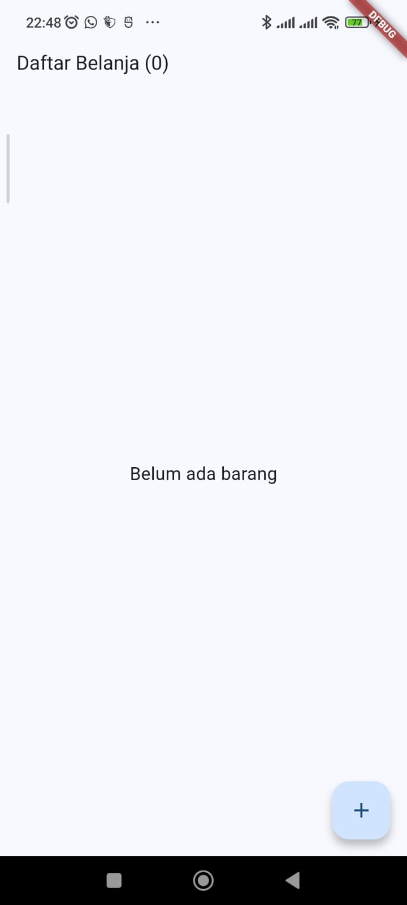
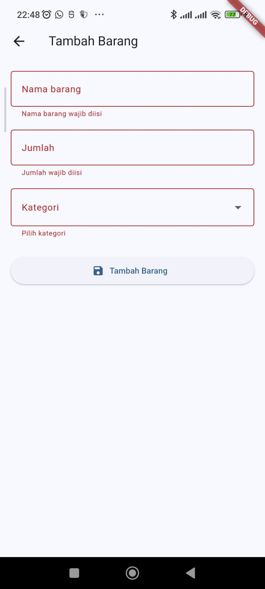
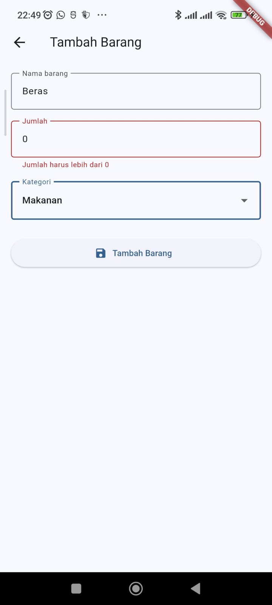
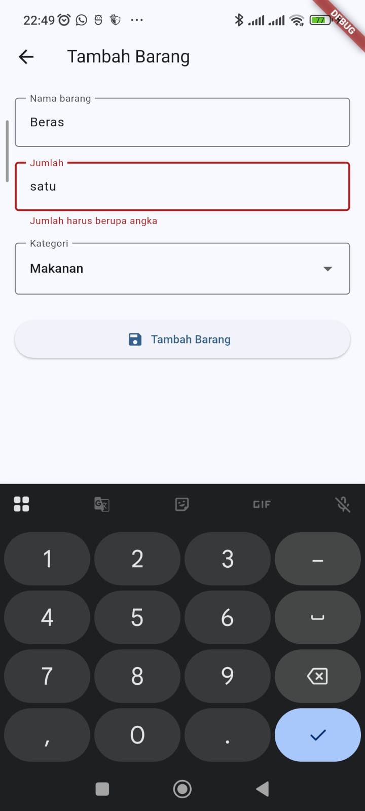
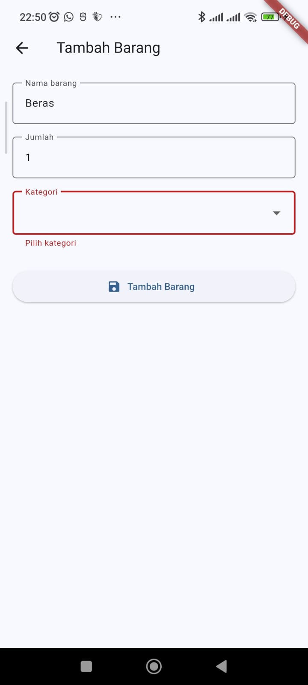
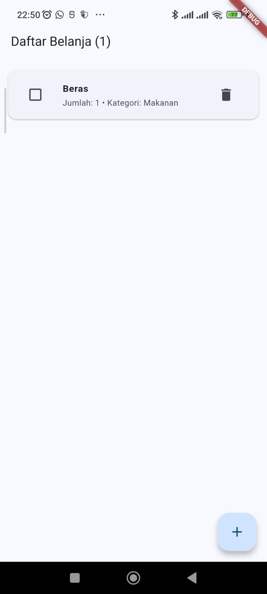
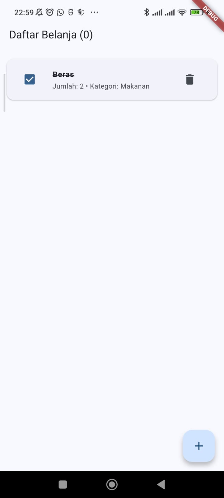

# Daftar Belanja

Aplikasi mobile sederhana berbasis Flutter untuk mengelola daftar kebutuhan belanja. Aplikasi ini memungkinkan pengguna menambahkan barang, menentukan jumlah dan kategori, menandai barang yang sudah dibeli, serta menghapus barang dari daftar.

Project ini dibuat sebagai bagian dari praktikum dan tugas mata kuliah **TI505 Pemrograman Mobile**.

## Informasi Project

| Keterangan | Detail |
|---|---|
| Nama Aplikasi | Daftar Belanja |
| Framework | Flutter |
| Bahasa Pemrograman | Dart |
| State Management | Provider |
| Package | provider |
| Platform | Android |

## Fitur Aplikasi

- **Menampilkan Daftar Barang** — Menampilkan seluruh barang yang telah dimasukkan pengguna.
- **Menambahkan Barang** — Pengguna dapat memasukkan nama barang, jumlah, dan kategori.
- **Validasi Formulir** — Memastikan nama barang dan jumlah telah diisi dengan benar serta kategori telah dipilih.
- **Checklist Barang** — Menandai barang yang sudah dibeli.
- **Menghapus Barang** — Menghapus barang dari daftar belanja.
- **Penghitung Barang** — Menampilkan jumlah barang yang belum dibeli pada AppBar.
- **Pesan Daftar Kosong** — Menampilkan informasi ketika belum ada barang yang ditambahkan.

## Teknologi yang Digunakan

| Teknologi | Fungsi |
|---|---|
| Flutter | Framework pengembangan aplikasi mobile |
| Dart | Bahasa pemrograman |
| Material Design 3 | Komponen dan tampilan antarmuka |
| Provider | Mengelola state aplikasi |
| ChangeNotifier | Memberikan notifikasi ketika data berubah |
| ListView.builder | Menampilkan daftar barang secara dinamis |
| TextFormField | Menerima input nama dan jumlah barang |
| DropdownButtonFormField | Memilih kategori barang |
| Navigator | Berpindah antara halaman daftar dan formulir |

## Struktur Project

```text
daftar_belanja/
├── android/
├── images/
│   ├── 1_daftarkosong.png
│   ├── 2_semuakosong.png
│   ├── 3_jumlah0.png
│   ├── 4_jumlahpakehuruf.png
│   ├── 5_kategorikosong.png
│   ├── 6_daftarbelanja.png
│   └── 7_ceklisbarang.png
├── ios/
├── lib/
│   └── main.dart
├── macos/
├── test/
├── web/
├── windows/
├── pubspec.yaml
├── pubspec.lock
└── README.md
```

## Konsep Implementasi

### 1. Class BarangBelanja

Class `BarangBelanja` digunakan sebagai model untuk merepresentasikan data barang yang terdiri dari nama, jumlah, kategori, dan status pembelian.

### 2. State Management dengan Provider

Aplikasi menggunakan `BelanjaModel` yang merupakan turunan dari `ChangeNotifier`. Class ini bertanggung jawab mengelola daftar barang melalui beberapa method:

- `tambah()` — Menambahkan barang baru.
- `toggle()` — Mengubah status pembelian barang.
- `hapus()` — Menghapus barang dari daftar.
- `jumlahBelumDibeli` — Menghitung barang yang belum dibeli.

Method `notifyListeners()` digunakan untuk memberi tahu widget ketika terjadi perubahan data sehingga tampilan dapat diperbarui.

### 3. Form Input dan Validasi

Halaman `FormBelanjaPage` menggunakan `Form`, `TextFormField`, dan `DropdownButtonFormField` untuk menerima input pengguna.

Validasi yang diterapkan meliputi:
- Nama barang wajib diisi.
- Jumlah wajib diisi.
- Jumlah harus berupa angka.
- Jumlah harus lebih dari nol.
- Kategori wajib dipilih.

### 4. Menampilkan Data

`ListView.builder` digunakan untuk menampilkan daftar barang secara dinamis. Setiap barang ditampilkan menggunakan `Card` dan `ListTile`.

Checkbox digunakan untuk mengubah status pembelian, sedangkan `IconButton` digunakan untuk menghapus barang.

## Dokumentasi Tampilan

### 1. Kondisi Daftar Kosong



### 2. Kondisi Seluruh Barang Kosong



### 3. Validasi Jumlah Kosong



### 4. Validasi Jumlah Bukan Angka



### 5. Validasi Kategori



### 6. Daftar Barang Belanja



### 7. Checklist Barang



## Cara Menjalankan Aplikasi

Pastikan Flutter SDK dan Dart SDK sudah terpasang.

1. Clone repository:

```bash
git clone https://github.com/illhammf/pemrograman-mobile.git
```

2. Masuk ke direktori project:

```bash
cd pemrograman-mobile/pertemuan-3/tugas/daftar_belanja
```

3. Unduh dependencies:

```bash
flutter pub get
```

4. Jalankan aplikasi:

```bash
flutter run
```

## Dependencies

Dependencies utama yang digunakan:

```yaml
dependencies:
  flutter:
    sdk: flutter
  cupertino_icons: ^1.0.8
  provider: ^6.1.5+1
```

## Pengujian

| No. | Skenario Pengujian | Hasil |
|---|---|---|
| 1 | Membuka aplikasi tanpa data barang | Berhasil |
| 2 | Menambahkan barang baru | Berhasil |
| 3 | Mengisi nama barang | Berhasil |
| 4 | Mengisi jumlah barang dengan angka | Berhasil |
| 5 | Memasukkan jumlah berupa huruf | Ditolak oleh validasi |
| 6 | Membiarkan nama barang kosong | Ditolak oleh validasi |
| 7 | Tidak memilih kategori | Ditolak oleh validasi |
| 8 | Menandai barang sudah dibeli | Berhasil |
| 9 | Menghapus barang | Berhasil |
| 10 | Memperbarui jumlah barang yang belum dibeli | Berhasil |

## Identitas Pengembang

| Keterangan | Identitas |
|---|---|
| Nama | Ilham Firmansyah |
| NIM | 20240801102 |
| Mata Kuliah | CIE511 Pemrograman Mobile |
| Project | Daftar Belanja |

---

**Catatan:** Aplikasi ini menggunakan Provider sebagai state management dan menyimpan data selama aplikasi berjalan. Penyimpanan permanen ke database belum diterapkan pada project ini.