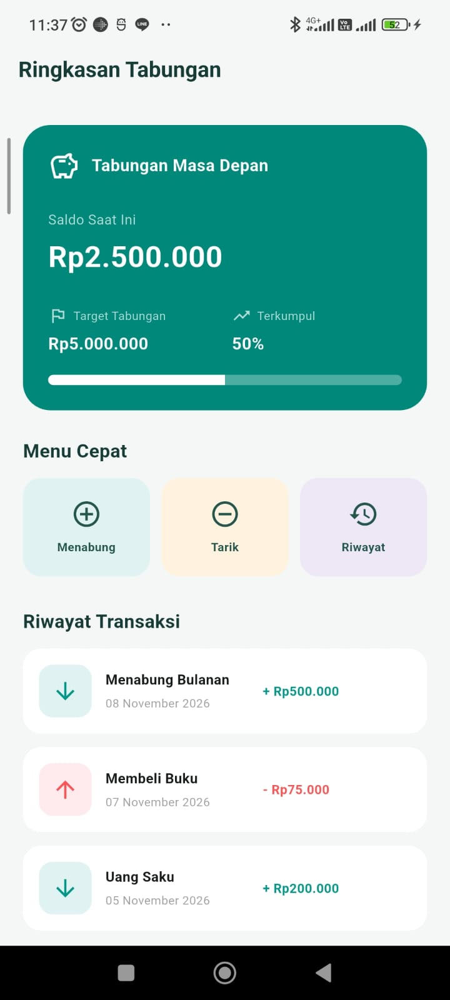
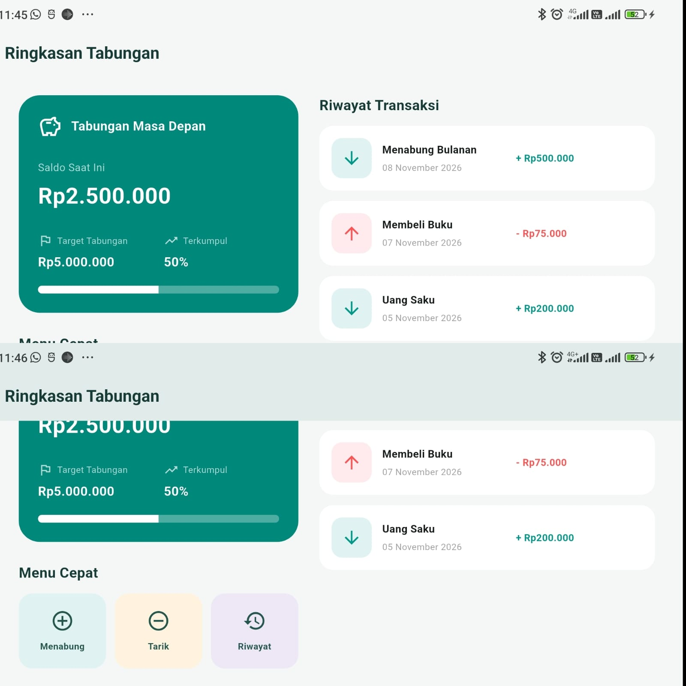

# TabungKu Layout – Ringkasan Tabungan

Aplikasi Flutter sederhana yang menampilkan halaman **Ringkasan Tabungan** menggunakan widget dasar Flutter. Proyek ini dibuat untuk memenuhi tugas Pertemuan 3 mata kuliah Pemrograman Mobile, dengan fokus pada penyusunan tata letak (layout) yang rapi dan responsif terhadap orientasi layar.

## Identitas

| Keterangan | Informasi |
|---|---|
| Nama | Ilham Firmansyah |
| NIM | 20240801102 |
| Mata Kuliah | TI505 – Pemrograman Mobile |
| Pertemuan | 3 |
| Nama Tugas | Menyusun Layout dengan Widget Dasar Flutter |
| Nama Proyek | TabungKu Layout |

## Deskripsi Aplikasi

TabungKu Layout merupakan rancangan antarmuka aplikasi tabungan yang menampilkan informasi saldo, target tabungan, dan riwayat transaksi dalam satu halaman.

Aplikasi ini menggunakan data transaksi statis (*hard-coded*) sesuai ketentuan tugas. Pengembangan difokuskan pada penerapan widget dasar Flutter untuk menghasilkan tampilan yang terstruktur, mudah dibaca, dan menyesuaikan orientasi layar.

## Fitur dan Komponen Tampilan

1. **AppBar**
   - Menampilkan judul halaman Ringkasan Tabungan.

2. **Kartu Ringkasan Tabungan**
   - Menampilkan nama tabungan.
   - Menampilkan saldo saat ini.
   - Menampilkan target tabungan.
   - Menampilkan persentase tabungan yang terkumpul.
   - Menampilkan indikator progres tabungan.

3. **Menu Cepat**
   - Menampilkan tiga ikon kategori, yaitu Menabung, Tarik, dan Riwayat.

4. **Riwayat Transaksi**
   - Menampilkan daftar transaksi.
   - Setiap transaksi memiliki judul, tanggal, dan nominal.
   - Menggunakan tampilan Card agar setiap transaksi terlihat terpisah dan rapi.

## Widget Dasar Flutter yang Digunakan

| Widget | Fungsi |
|---|---|
| `MaterialApp` | Menjadi komponen utama aplikasi dan mengatur tema. |
| `Scaffold` | Menyediakan struktur dasar halaman. |
| `AppBar` | Menampilkan judul halaman. |
| `Container` | Membuat kartu ringkasan dengan warna dan dekorasi. |
| `Card` | Membungkus setiap item transaksi. |
| `Padding` | Memberikan jarak di sekitar elemen. |
| `SizedBox` | Mengatur jarak antarwidget. |
| `Column` | Menyusun elemen secara vertikal. |
| `Row` | Menyusun elemen secara horizontal. |
| `Expanded` | Membagi ruang yang tersedia agar teks menyesuaikan lebar layar. |
| `Text` | Menampilkan informasi dan keterangan. |
| `Icon` | Menampilkan ikon visual. |
| `ListView` | Menyusun daftar transaksi. |

## Struktur Widget (Widget Tree)

Gambaran struktur widget utama aplikasi:

```text
MaterialApp
└── RingkasanPage
    └── Scaffold
        ├── AppBar
        │   └── Text
        │
        └── Body
            └── Column
                ├── Judul Halaman
                │
                └── Row
                    ├── Expanded
                    │   └── Column
                    │       ├── Kartu Ringkasan
                    │       │   └── Container
                    │       │       └── Column
                    │       │           ├── Row
                    │       │           ├── Text
                    │       │           ├── Row
                    │       │           └── LinearProgressIndicator
                    │       │
                    │       └── Menu Cepat
                    │
                    └── Expanded
                        └── Column
                            ├── Judul Riwayat Transaksi
                            └── ListView
                                └── Card
                                    └── ListTile
```

Struktur tersebut menggambarkan pembagian area utama halaman menjadi kartu ringkasan dan riwayat transaksi. Penggunaan `Expanded` membantu mengatur pembagian ruang agar konten dapat menyesuaikan ukuran layar.

## Dokumentasi Tampilan

Berikut merupakan hasil tampilan aplikasi TabungKu Layout pada dua orientasi layar.

### 1. Tampilan Portrait

Tampilan portrait memperlihatkan halaman Ringkasan Tabungan dalam orientasi layar tegak.



### 2. Tampilan Landscape

Tampilan landscape memperlihatkan penyesuaian tata letak ketika perangkat berada dalam orientasi mendatar. Kartu ringkasan dan riwayat transaksi disusun berdampingan.



## Teknologi yang Digunakan

- **Bahasa Pemrograman:** Dart
- **Framework:** Flutter
- **IDE:** Visual Studio Code
- **Platform Pengembangan:** Android
- **Data:** Statis (*hard-coded*)
- **Package Tambahan:** Tidak menggunakan package pihak ketiga untuk implementasi layout.

## Cara Menjalankan Aplikasi

Pastikan Flutter SDK sudah terpasang dan perangkat Android atau emulator telah terhubung.

1. Clone repository:

```bash
git clone https://github.com/illhammf/pemrograman-mobile.git
```

2. Masuk ke direktori proyek:

```bash
cd pemrograman-mobile/pertemuan-3/tugas/tabungku_layout
```

3. Unduh dependensi:

```bash
flutter pub get
```

4. Jalankan pemeriksaan kode:

```bash
flutter analyze
```

5. Jalankan pengujian:

```bash
flutter test
```

6. Jalankan aplikasi:

```bash
flutter run
```

## Hasil Pengujian

Pengujian dilakukan untuk memastikan aplikasi dapat dijalankan dan komponen utama halaman berhasil ditampilkan.

| No. | Pengujian | Hasil |
|---|---|---|
| 1 | Menampilkan halaman Ringkasan Tabungan | Lulus |
| 2 | Menampilkan AppBar dan judul halaman | Lulus |
| 3 | Menampilkan kartu ringkasan tabungan | Lulus |
| 4 | Menampilkan tiga ikon menu cepat | Lulus |
| 5 | Menampilkan daftar minimal tiga transaksi | Lulus |
| 6 | Menyesuaikan layout portrait | Lulus |
| 7 | Menyesuaikan layout landscape | Lulus |
| 8 | Pemeriksaan kode menggunakan `flutter analyze` | Lulus |
| 9 | Pengujian widget menggunakan `flutter test` | Lulus |

**Hasil pemeriksaan kode:**

```text
Analyzing tabungku_layout...
No issues found!
```

**Hasil pengujian widget:**

```text
00:04 +1: All tests passed!
```

## Kesimpulan

Berdasarkan hasil pengerjaan, aplikasi TabungKu Layout berhasil dibuat menggunakan widget dasar Flutter. Halaman utama menampilkan kartu ringkasan tabungan, menu cepat, dan riwayat transaksi dengan susunan yang terstruktur.

Penggunaan `Row`, `Column`, `Container`, `Card`, `Padding`, `SizedBox`, dan `Expanded` membantu membentuk tata letak yang rapi serta menyesuaikan orientasi layar portrait dan landscape.

Aplikasi juga berhasil melewati pemeriksaan kode menggunakan `flutter analyze` dan pengujian widget menggunakan `flutter test`.

Proyek ini menjadi penerapan materi penyusunan layout dengan widget dasar Flutter pada Pertemuan 3.

---

**Repository:** [pemrograman-mobile](https://github.com/illhammf/pemrograman-mobile)

**Folder Proyek:** `pertemuan-3/tugas/tabungku_layout/`