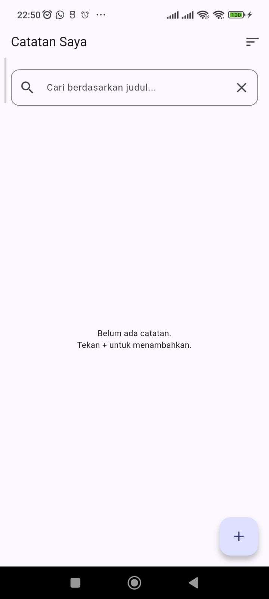
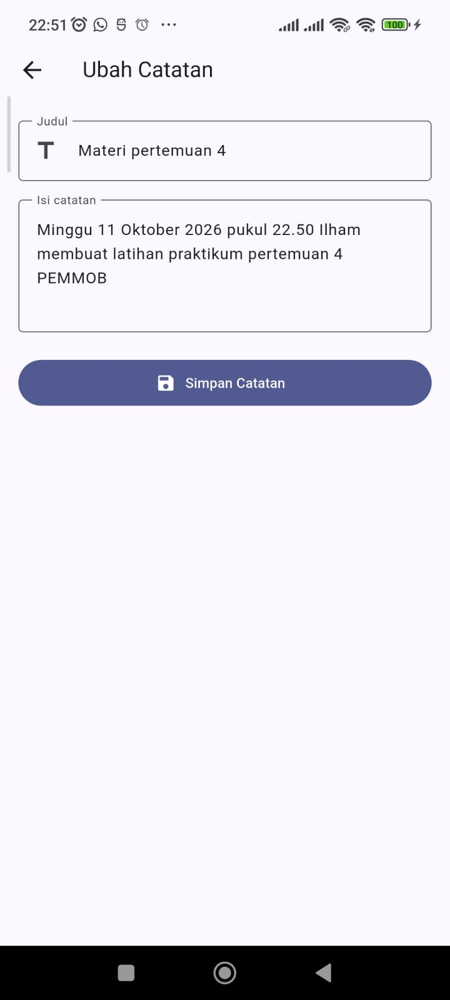
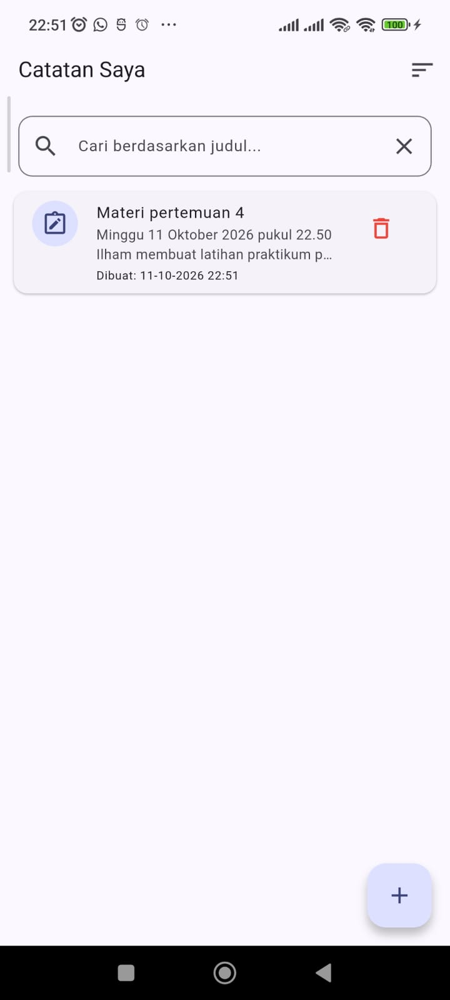
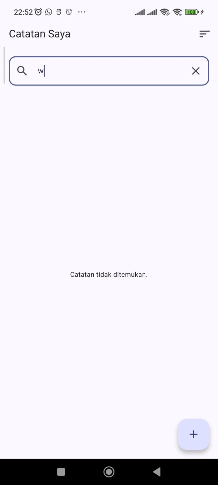
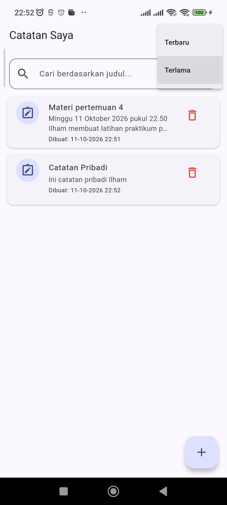
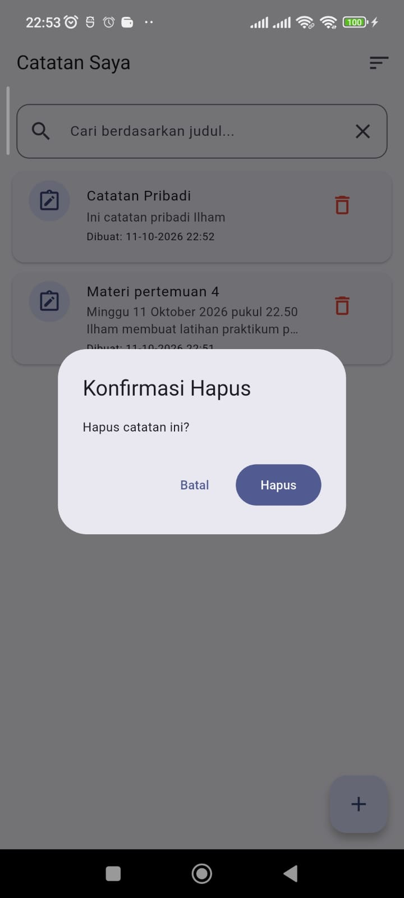

# Latihan Mandiri Pertemuan 5 — Penyimpanan Lokal

## Deskripsi

Latihan mandiri ini menerapkan penyimpanan lokal menggunakan SQLite dan SharedPreferences pada Flutter. Aplikasi Catatan Saya memiliki fitur pencarian, konfirmasi penghapusan, pencatatan tanggal dibuat, dan pengaturan urutan daftar.

## Fitur

1. **Konfirmasi hapus:** menampilkan dialog “Hapus catatan ini?” sebelum catatan dihapus.
2. **Pencarian:** memfilter catatan berdasarkan judul menggunakan query SQLite `LIKE` dan parameter `whereArgs`.
3. **Tanggal dibuat:** menyimpan dan menampilkan tanggal serta waktu pembuatan catatan.
4. **Migrasi database:** menggunakan database versi 2 dan `onUpgrade` untuk menambahkan kolom `dibuat` pada database versi sebelumnya.
5. **Urutan daftar:** menyediakan pilihan Terbaru dan Terlama. Pilihan disimpan menggunakan SharedPreferences.
6. **CRUD:** menambah, membaca, mengubah, dan menghapus catatan.
7. **Penyimpanan permanen:** catatan tetap tersedia setelah aplikasi ditutup dan dibuka kembali.

## Teknologi

- Flutter dan Dart
- SQLite melalui paket `sqflite`
- Paket `path` untuk lokasi database
- SharedPreferences untuk menyimpan pilihan urutan

## Cara Menjalankan

Dari folder `pertemuan-5/praktikum`, jalankan:

```bash
flutter pub get
flutter run -t latihan-mandiri/main.dart
```

Jalankan aplikasi pada emulator atau perangkat Android.

## Struktur Folder

```text
praktikum/
└── latihan-mandiri/
    ├── main.dart
    ├── README.md
    └── screenshots/
        ├── 01_catatankosong.png
        ├── 02_tambahcatatan.png
        ├── 03_catatanmasuk.png
        ├── 04_mencaricatatan.png
        ├── 05_urutkancatatan.png
        └── 06_hapuscatatan.png
```

## Pengujian

- Tambahkan beberapa catatan dengan judul berbeda.
- Tekan ikon hapus dan pastikan dialog konfirmasi muncul.
- Batalkan penghapusan dan pastikan catatan tetap ada.
- Cari catatan berdasarkan sebagian judul.
- Periksa tanggal dan waktu pembuatan catatan.
- Pilih urutan Terlama, tutup aplikasi, lalu buka kembali dan pastikan pilihan urutan tersimpan.
- Tutup aplikasi sepenuhnya, buka lagi, lalu pastikan catatan masih tersedia.

## Screenshot
### Catatan Kosong


### Tambah Catatan


### Catatan Masuk


### Mencari Catatan


### Urutkan Catatan


### Hapus Catatan


## Catatan Migrasi Database

Database baru dibuat dengan skema versi 2. Jika database versi 1 sudah ada, `onUpgrade` menambahkan kolom `dibuat` dan mengisi nilai tanggal untuk catatan lama. Jika struktur database diubah tanpa menaikkan versi, migrasi yang diperlukan tidak akan berjalan otomatis.

## Kesimpulan

Latihan ini menunjukkan penggunaan SQLite untuk menyimpan data terstruktur dan SharedPreferences untuk menyimpan pengaturan sederhana. Query parameter, migrasi database, dan konfirmasi penghapusan membantu membuat aplikasi lebih aman dan mudah digunakan.
