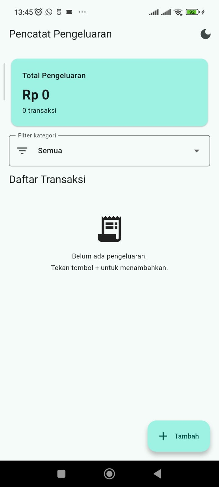
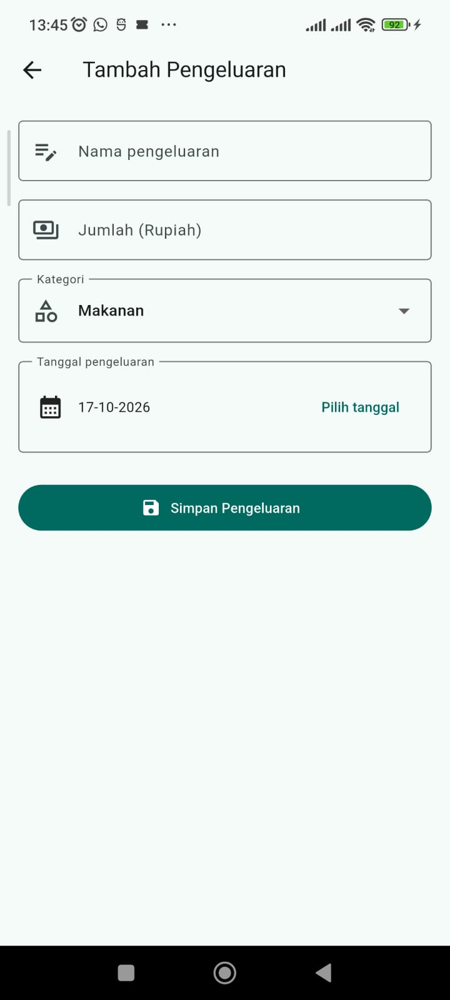
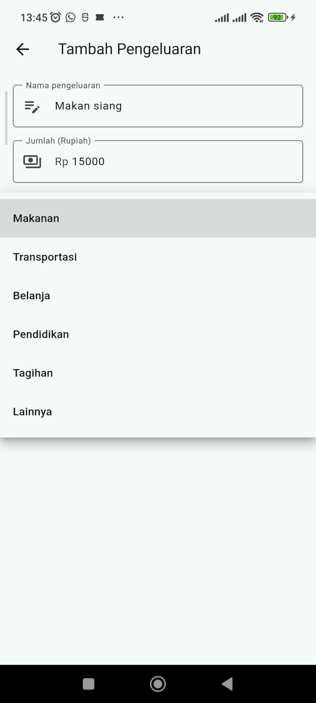
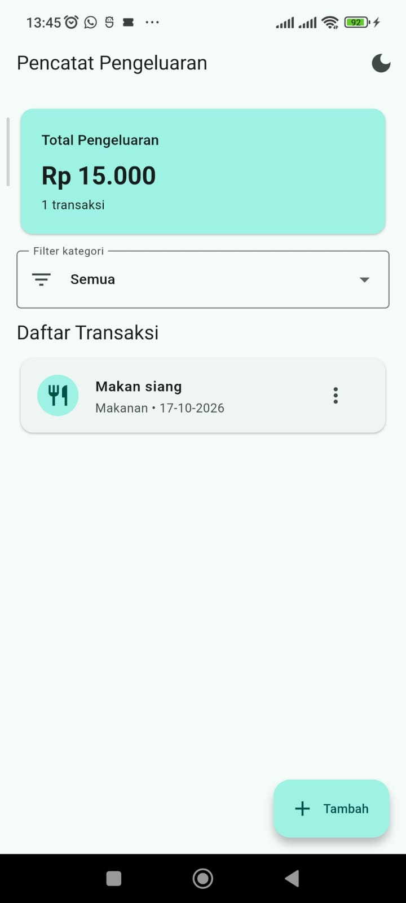
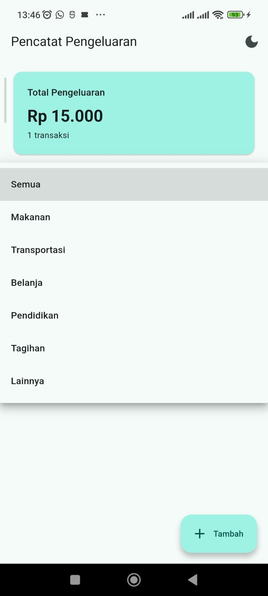
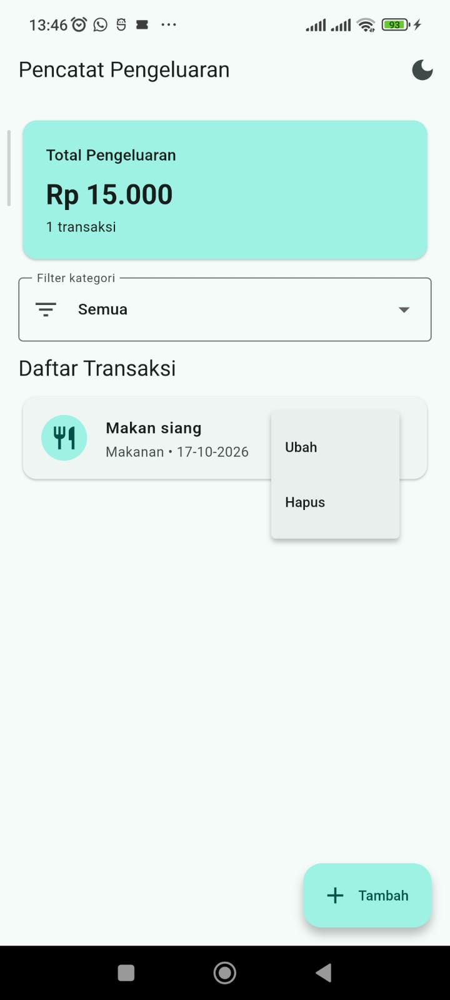
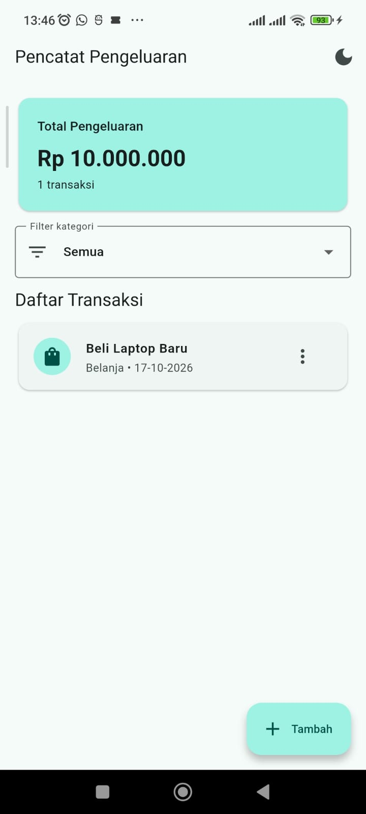
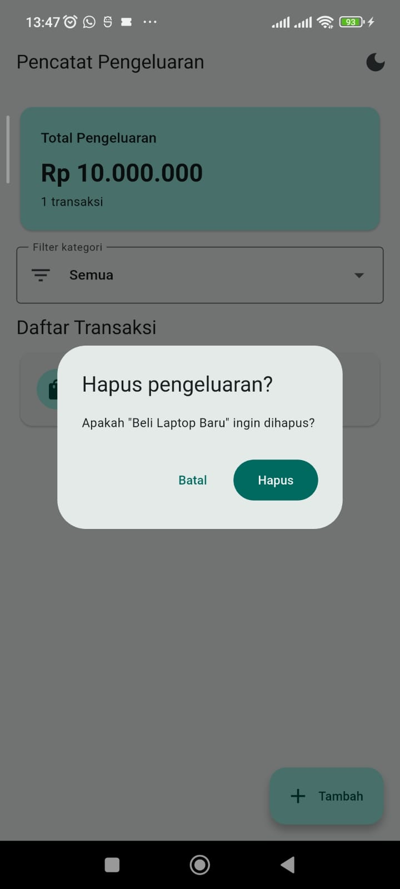
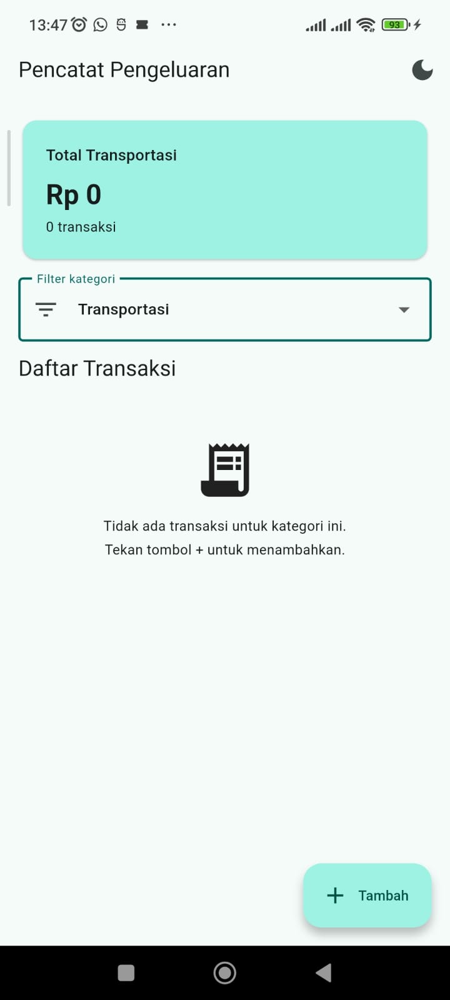
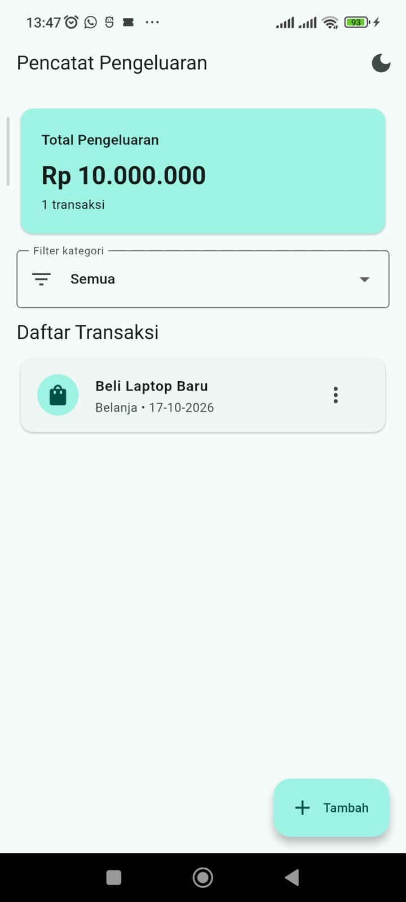

# Tugas Pertemuan 5 — Pencatat Pengeluaran

## 1. Deskripsi Proyek

Pencatat Pengeluaran adalah aplikasi mobile berbasis Flutter yang digunakan untuk mencatat dan mengelola pengeluaran sehari-hari. Aplikasi ini menerapkan penyimpanan lokal menggunakan SQLite sehingga data tetap tersimpan meskipun aplikasi ditutup dan dibuka kembali.

Aplikasi dibuat untuk memenuhi tugas Pertemuan 5 mata kuliah Pemrograman Mobile dengan materi Penyimpanan Lokal menggunakan SharedPreferences dan SQLite.

## 2. Tujuan

Tujuan pembuatan aplikasi ini adalah:

1. Memahami penggunaan SQLite sebagai penyimpanan data lokal.
2. Mengimplementasikan operasi CRUD (*Create, Read, Update, Delete*).
3. Membuat formulir input dengan validasi.
4. Mengelola kategori dan tanggal pengeluaran.
5. Menampilkan total pengeluaran.
6. Menggunakan SharedPreferences untuk menyimpan pengaturan aplikasi.
7. Memastikan data tetap tersedia setelah aplikasi ditutup dan dibuka kembali.

## 3. Fitur Aplikasi

Fitur yang dikembangkan dalam aplikasi Pencatat Pengeluaran meliputi:

- **Tambah pengeluaran:** mencatat pengeluaran baru.
- **Daftar pengeluaran:** menampilkan catatan pengeluaran yang tersimpan.
- **Detail dan ubah pengeluaran:** melihat serta memperbarui catatan.
- **Hapus pengeluaran:** menghapus catatan melalui konfirmasi.
- **Validasi formulir:** memastikan data yang dimasukkan memenuhi ketentuan.
- **Kategori pengeluaran:** mengelompokkan pengeluaran berdasarkan kategori.
- **Pemilihan tanggal:** menentukan tanggal transaksi.
- **Total pengeluaran:** menghitung jumlah pengeluaran yang tercatat.
- **Filter kategori:** menampilkan catatan berdasarkan kategori yang dipilih.
- **Mode gelap:** menyediakan pilihan tampilan gelap yang pengaturannya disimpan menggunakan SharedPreferences.
- **Penyimpanan lokal:** menyimpan data menggunakan SQLite agar tetap tersedia setelah aplikasi dibuka kembali.

## 4. Teknologi yang Digunakan

| Teknologi | Kegunaan |
|---|---|
| Flutter | Framework pengembangan aplikasi mobile |
| Dart | Bahasa pemrograman |
| SQLite | Menyimpan data pengeluaran secara lokal |
| `sqflite` | Mengakses database SQLite |
| `path` | Membantu menentukan lokasi file database |
| `shared_preferences` | Menyimpan pengaturan sederhana aplikasi |

## 5. Struktur Proyek

```text
pencatat_pengeluaran/
├── lib/
│   └── main.dart
├── screenshots/
│   ├── 01_halamanutama.png
│   ├── 02_tambahpengeluaran.png
│   ├── 03_jeniskategori.png
│   ├── 04_pemilihtanggal.png
│   ├── 05_halamanutamaupdate.png
│   ├── 06_kategoridihalamanutama.png
│   ├── 07_tombolubahdanhapus.png
│   ├── 08_pengeluarandiubah.png
│   ├── 09_validasiuntukhapus.png
│   ├── 10_pilihkategori.png
│   ├── 11_modelgelap.png
│   └── 12_setelahdirestart.png
├── pubspec.yaml
├── pubspec.lock
└── README.md
```

## 6. Dokumentasi Screenshot

### 6.1 Halaman Utama



Screenshot ini menunjukkan tampilan awal aplikasi Pencatat Pengeluaran.

### 6.2 Form Tambah Pengeluaran



Screenshot ini menunjukkan formulir untuk memasukkan data pengeluaran baru.

### 6.3 Pemilihan Kategori



Screenshot ini memperlihatkan pilihan kategori yang tersedia untuk pengeluaran.

### 6.4 Pemilihan Tanggal


Screenshot ini memperlihatkan fitur pemilihan tanggal transaksi.

### 6.5 Halaman Utama Setelah Data Ditambahkan



Screenshot ini menunjukkan halaman utama setelah data pengeluaran ditambahkan atau diperbarui.

### 6.6 Kategori pada Halaman Utama



Screenshot ini menunjukkan informasi kategori pengeluaran pada daftar utama.

### 6.7 Tombol Ubah dan Hapus



Screenshot ini memperlihatkan pilihan tindakan untuk mengubah atau menghapus catatan pengeluaran.

### 6.8 Data Pengeluaran Setelah Diubah



Screenshot ini menunjukkan data pengeluaran setelah dilakukan perubahan.

### 6.9 Konfirmasi Penghapusan



Screenshot ini mendokumentasikan proses konfirmasi sebelum catatan pengeluaran dihapus.

### 6.10 Filter Kategori



Screenshot ini menunjukkan pilihan kategori untuk menyaring daftar pengeluaran.

### 6.11 Mode Gelap


Screenshot ini memperlihatkan tampilan aplikasi ketika mode gelap diaktifkan.

### 6.12 Data Setelah Aplikasi Direstart



Screenshot ini digunakan untuk mendokumentasikan kondisi aplikasi setelah ditutup dan dibuka kembali, sebagai bukti pengujian penyimpanan data lokal.

## 7. Struktur Database

Aplikasi menggunakan SQLite untuk menyimpan data pengeluaran. Tabel `pengeluaran` memiliki struktur berikut:

| Kolom | Tipe Data | Keterangan |
|---|---|---|
| `id` | INTEGER | Primary key dengan penambahan otomatis |
| `nama` | TEXT | Nama atau keterangan pengeluaran |
| `jumlah` | INTEGER | Nominal pengeluaran |
| `kategori` | TEXT | Kategori pengeluaran |
| `tanggal` | TEXT | Tanggal transaksi |

Database lokal memungkinkan aplikasi membaca, menambahkan, memperbarui, dan menghapus data tanpa memerlukan koneksi internet.

## 8. Validasi dan Pengujian

Pengujian aplikasi dilakukan untuk memeriksa fungsi utama, antara lain:

1. Menambahkan catatan pengeluaran.
2. Memastikan formulir menolak data yang tidak valid.
3. Memilih kategori dan tanggal pengeluaran.
4. Memperbarui catatan yang sudah tersimpan.
5. Menghapus catatan melalui konfirmasi.
6. Memilih kategori untuk menyaring daftar pengeluaran.
7. Memeriksa tampilan mode gelap.
8. Menutup dan membuka kembali aplikasi untuk memeriksa persistensi data.

Hasil pengujian didokumentasikan melalui screenshot yang tersedia pada folder `screenshots/`.

## 9. Cara Menjalankan Aplikasi

Pastikan Flutter dan perangkat atau emulator Android telah tersedia.

Jalankan perintah berikut dari direktori proyek:

```bash
flutter pub get
flutter run
```

## 10. Kesimpulan

Aplikasi Pencatat Pengeluaran merupakan implementasi penyimpanan lokal pada Flutter menggunakan SQLite dan SharedPreferences. SQLite digunakan untuk mengelola data pengeluaran, sedangkan SharedPreferences digunakan untuk menyimpan pengaturan sederhana aplikasi.

Melalui proyek ini, konsep CRUD, validasi formulir, pengelolaan kategori, pemilihan tanggal, filter data, dan persistensi data dapat diterapkan dalam sebuah aplikasi mobile.

Proyek ini menjadi sarana praktik untuk memahami pengelolaan data lokal pada pengembangan aplikasi menggunakan Flutter dan Dart.
