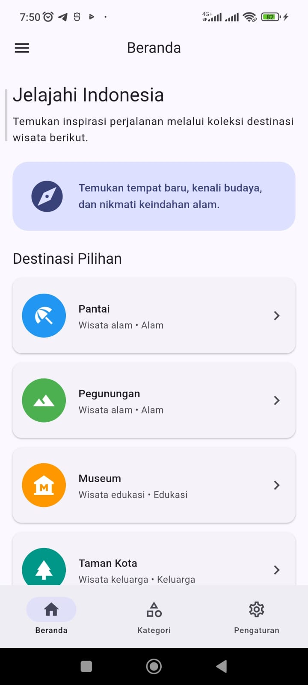
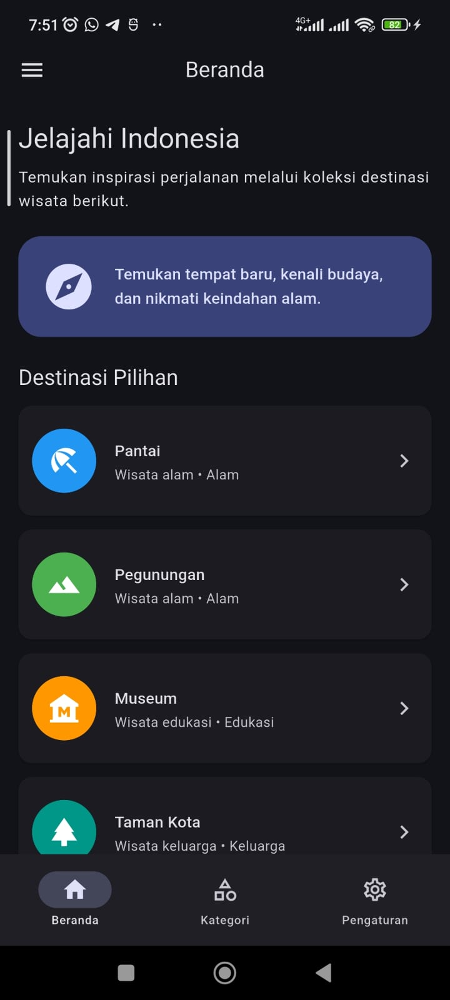
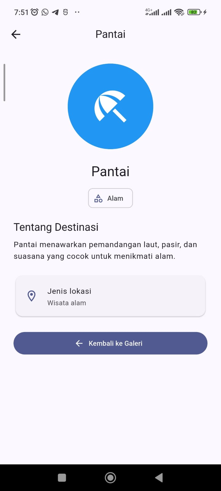
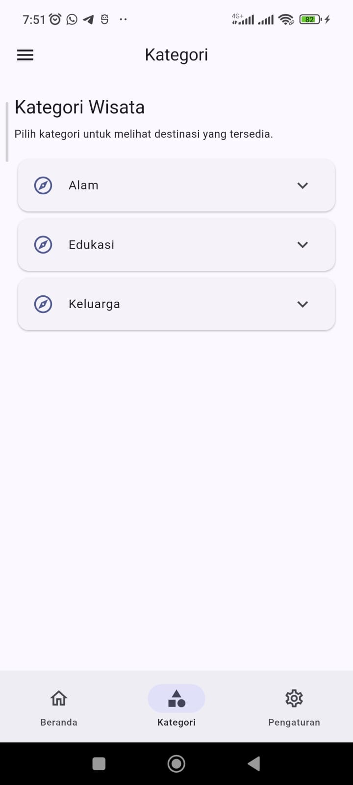
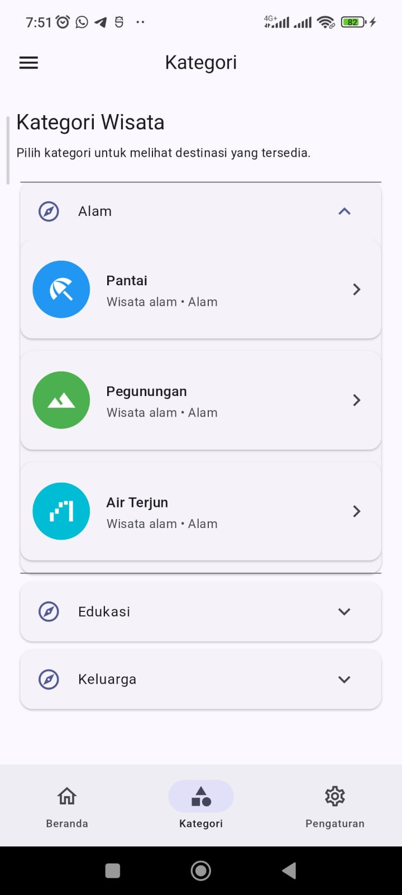
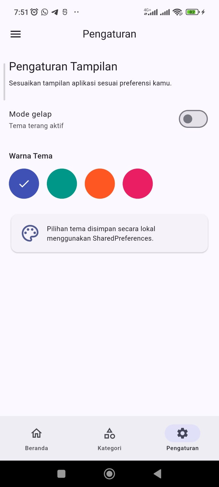

# 🌏 Galeri Katalog Interaktif — Flutter

## 📌 Deskripsi Proyek

**Galeri Katalog Interaktif** adalah aplikasi mobile berbasis Flutter yang menampilkan katalog destinasi wisata dengan tampilan yang interaktif. Aplikasi ini dibuat untuk menerapkan materi Pertemuan 6 mata kuliah Pemrograman Mobile, khususnya pengelolaan tema, navigasi halaman, pengiriman argumen, dan animasi.

Pengguna dapat menjelajahi daftar destinasi, melihat informasi berdasarkan kategori, membuka halaman detail, serta menyesuaikan warna dan mode tampilan aplikasi.

Aplikasi ini juga menggunakan **SharedPreferences** untuk menyimpan pilihan tema sehingga pengaturan tetap tersimpan ketika aplikasi ditutup dan dibuka kembali.

## 🎯 Tujuan Pembelajaran

1. Memahami penggunaan `ThemeData`, `ThemeMode`, dan `colorSchemeSeed`.
2. Menerapkan navigasi menggunakan `NavigationBar` dan `IndexedStack`.
3. Memahami named routes dan pengiriman argumen menggunakan `Navigator.pushNamed()`.
4. Menerapkan animasi perpindahan halaman menggunakan `Hero`.
5. Memahami penerapan animasi implisit menggunakan `AnimatedContainer`.
6. Mengelola preferensi pengguna menggunakan SharedPreferences.
7. Membuat aplikasi dengan tampilan yang menyesuaikan tema terang dan gelap.

## ✨ Fitur Aplikasi

### 1. Beranda

Menampilkan pengenalan aplikasi, kartu informasi, dan daftar destinasi wisata yang dapat dipilih pengguna.

### 2. Kategori

Mengelompokkan destinasi berdasarkan kategori, seperti:
- Alam
- Edukasi
- Keluarga

Pengguna dapat membuka kategori untuk melihat destinasi yang tersedia.

### 3. Halaman Detail

Menampilkan informasi destinasi yang dipilih, termasuk nama, kategori, jenis lokasi, deskripsi, dan ikon destinasi.

Halaman detail dibuka menggunakan named route `/detail`, dengan objek `Destinasi` dikirim melalui argumen navigasi.

### 4. Pengaturan Tema

Pengguna dapat:
- Mengaktifkan mode terang.
- Mengaktifkan mode gelap.
- Memilih warna tema indigo, teal, deep orange, atau pink.
- Menyimpan pilihan tema secara lokal menggunakan SharedPreferences.

### 5. Navigasi dan Animasi

Aplikasi menerapkan `NavigationBar`, `IndexedStack`, `Hero`, dan `AnimatedContainer` untuk mendukung navigasi dan tampilan yang interaktif.

## 🛠️ Teknologi yang Digunakan

| Teknologi | Kegunaan |
|---|---|
| Flutter | Framework pengembangan aplikasi |
| Dart | Bahasa pemrograman |
| Material Design 3 | Komponen dan desain antarmuka |
| SharedPreferences | Penyimpanan preferensi tema |
| Navigator | Navigasi antarhalaman |
| Hero | Animasi transisi antarhalaman |
| AnimatedContainer | Animasi perubahan properti tampilan |

## 📂 Struktur Folder

```text
galeri_katalog/
├── android/
├── ios/
├── lib/
│   └── main.dart
├── screenshots/
│   ├── 01_beranda-tema-terang.png
│   ├── 02_beranda-tema-gelap.png
│   ├── 03_halaman-detail-hero.png
│   ├── 04_halaman-kategori.png
│   ├── 05_halaman-detail-kategori.png
│   ├── 06_pengaturan-warna.png
│   └── 07_tema-setelah-restart.png
├── test/
│   └── widget_test.dart
├── pubspec.yaml
├── pubspec.lock
└── README.md
```

## 🚀 Cara Menjalankan Aplikasi

### 1. Masuk ke direktori proyek

Jalankan perintah berikut dari terminal:

```bash
cd ~/perkuliahan/pemrograman_mobile/pemrograman-mobile/pertemuan-6/tugas/galeri_katalog
```

### 2. Unduh dependensi

```bash
flutter pub get
```

### 3. Periksa konfigurasi Flutter

```bash
flutter doctor
```

Pastikan perangkat yang akan digunakan untuk menjalankan aplikasi sudah terdeteksi oleh Flutter.

### 4. Jalankan aplikasi

```bash
flutter run
```

## 📸 Dokumentasi Tampilan Aplikasi

Screenshot berikut merupakan dokumentasi hasil implementasi aplikasi Galeri Katalog Interaktif.

### 1. Beranda — Tema Terang

Menampilkan halaman utama aplikasi dengan tema terang dan daftar destinasi wisata.



### 2. Beranda — Tema Gelap

Menampilkan halaman utama ketika mode gelap diaktifkan.



### 3. Halaman Detail dengan Hero

Menampilkan informasi destinasi yang dipilih serta transisi elemen menggunakan animasi Hero.



### 4. Halaman Kategori

Menampilkan daftar destinasi berdasarkan kategori wisata.



### 5. Detail Destinasi dari Kategori

Dokumentasi tampilan detail destinasi yang dibuka melalui bagian kategori.



### 6. Pengaturan Warna Tema

Menampilkan pilihan warna tema dan pengaturan mode terang atau gelap.



### 7. Tema Setelah Aplikasi Dibuka Kembali

Menunjukkan bahwa preferensi tema yang disimpan tetap diterapkan setelah aplikasi dimulai kembali.


## 🧰 Catatan Perbaikan dan Penyelesaian Error

Selama pengembangan, terdapat beberapa kendala yang perlu diperbaiki agar aplikasi dapat dijalankan dengan baik.

### 1. Error `MyApp isn't a class` pada `widget_test.dart`

**Penyebab:** File pengujian bawaan Flutter masih memanggil widget `MyApp`, sedangkan aplikasi ini menggunakan widget utama `GaleriApp`.

**Perbaikan:** File `test/widget_test.dart` disesuaikan agar tidak lagi memanggil `MyApp`. Pengujian dasar yang digunakan sementara hanya memeriksa operasi sederhana:

```dart
import 'package:flutter_test/flutter_test.dart';

void main() {
  test('Pengujian dasar proyek Galeri Katalog', () {
    expect(1 + 1, 2);
  });
}
```

Tes tersebut bukan pengujian tampilan aplikasi, melainkan tes sederhana agar tidak bergantung pada nama widget bawaan Flutter.

### 2. Error `Null check operator used on a null value`

**Pesan error:**

```text
_TypeError: Null check operator used on a null value
```

Stack trace menunjukkan bahwa error terjadi ketika Flutter membangun `MaterialApp`, melalui mekanisme pembentukan route bawaan.

**Perbaikan yang dilakukan:** Konfigurasi navigasi diperbarui dengan menggunakan `home: GaleriShell(...)` sebagai halaman awal, serta menangani route `/detail` melalui `onGenerateRoute`.

Perbaikan tersebut bertujuan untuk menyederhanakan pembentukan route awal dan memastikan route yang tidak dikenal diarahkan ke halaman 404. Perubahan ini dilakukan setelah error ditemukan pada proses navigasi.

### 3. Penanganan kegagalan SharedPreferences

Fungsi `_muatPengaturan()` diperbarui menggunakan `try-catch`. Jika pemuatan preferensi gagal, aplikasi menggunakan pengaturan default berupa tema terang dan warna indigo.

Pendekatan ini membantu mencegah kegagalan membaca preferensi membuat aplikasi terus berada di layar loading. Namun, penanganan tersebut tidak otomatis menyelesaikan semua kemungkinan error lain.

### 4. Perbaikan transisi Hero pada tab Kategori

Kartu destinasi pada Beranda dan Kategori dapat menampilkan destinasi yang sama. Untuk menghindari konflik tag Hero ketika beberapa kartu dengan tag identik berada dalam widget tree yang sama, animasi Hero dinonaktifkan pada kartu di Kategori.

Animasi Hero tetap digunakan pada kartu Beranda yang membuka halaman detail.

### 5. Menjalankan ulang aplikasi setelah perubahan

Setelah perubahan kode disimpan, aplikasi dijalankan ulang menggunakan:

```bash
flutter run
```

Jika diperlukan untuk membersihkan hasil build sebelumnya, jalankan:

```bash
flutter clean
flutter pub get
flutter run
```

Perintah `flutter clean` merupakan langkah pembersihan build, bukan jaminan untuk memperbaiki semua error saat runtime.

## ✅ Checklist Pengujian

- [ ] Aplikasi dapat dibuka di perangkat Android.
- [ ] Beranda menampilkan daftar destinasi.
- [ ] Tab Beranda, Kategori, dan Pengaturan dapat digunakan.
- [ ] Kategori dapat dibuka dan menampilkan destinasi.
- [ ] Halaman detail menerima data destinasi dengan benar.
- [ ] Animasi Hero berjalan saat membuka detail dari Beranda.
- [ ] Animasi implisit pada `AnimatedContainer` dapat diamati ketika propertinya berubah.
- [ ] Mode terang dan gelap dapat diubah.
- [ ] Pilihan warna tema dapat diubah.
- [ ] Pengaturan tema tetap tersimpan setelah aplikasi dibuka kembali.
- [ ] Route yang tidak dikenal menampilkan halaman 404.

## 📝 Kesimpulan

Melalui proyek Galeri Katalog Interaktif, materi Flutter mengenai navigasi, tema aplikasi, animasi, dan penyimpanan preferensi diterapkan dalam satu aplikasi mobile.

Proyek ini menjadi sarana untuk memahami bagaimana beberapa komponen Flutter dapat digabungkan untuk menghasilkan aplikasi yang terstruktur dan interaktif. Dokumentasi screenshot serta catatan perbaikan error disertakan sebagai bukti proses pengembangan.

---

**Mata Kuliah:** Pemrograman Mobile  
**Pertemuan:** 6  
**Proyek:** Galeri Katalog Interaktif  
**Framework:** Flutter