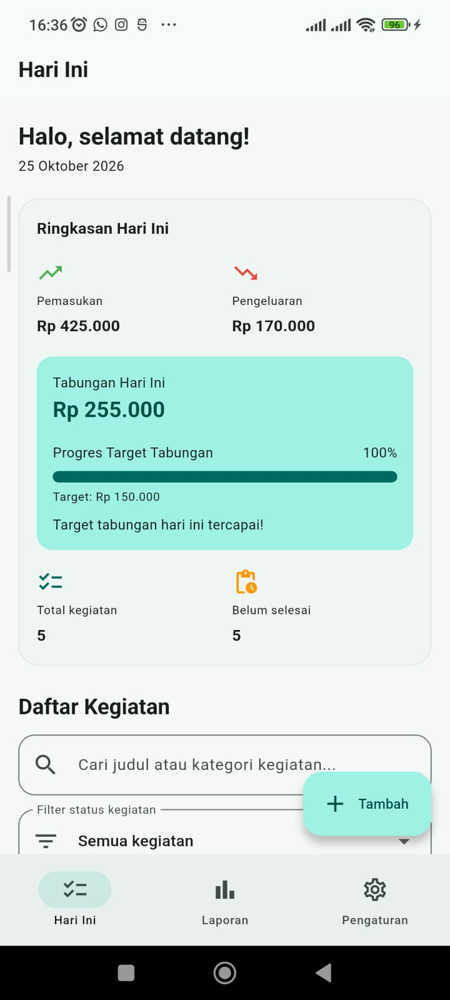
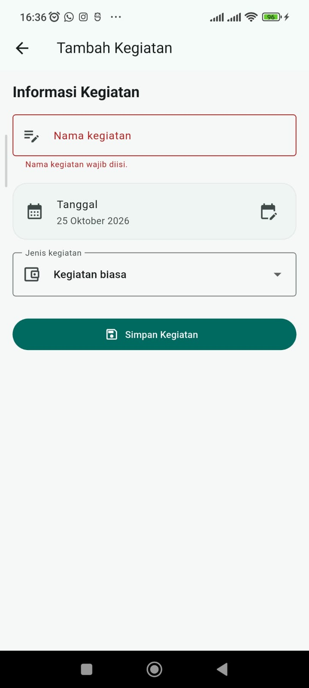
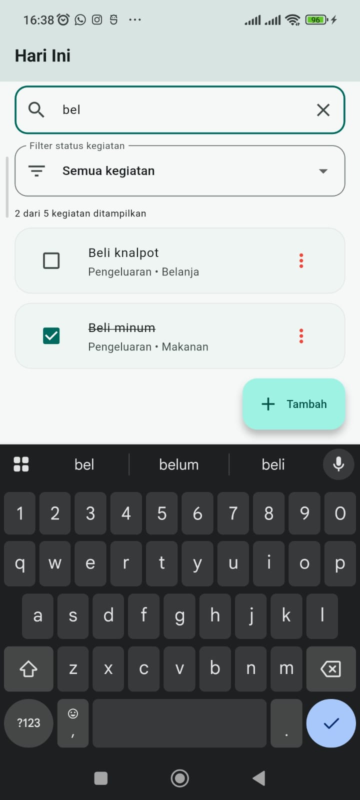
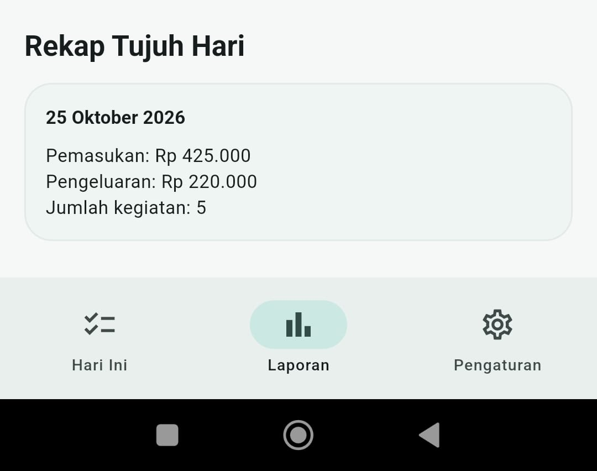
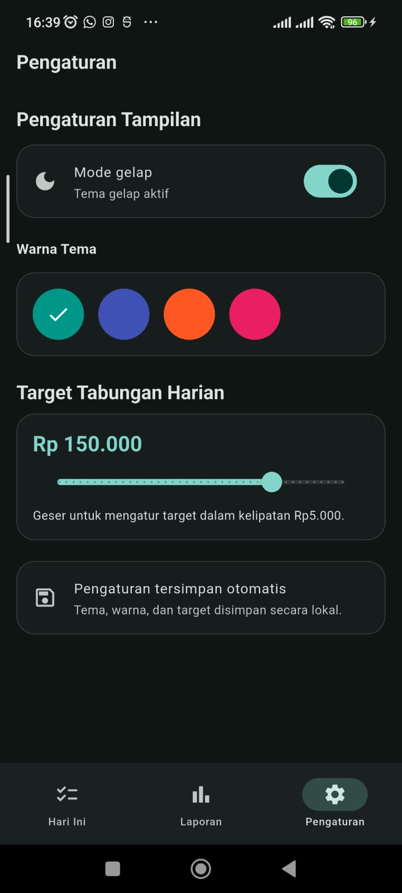
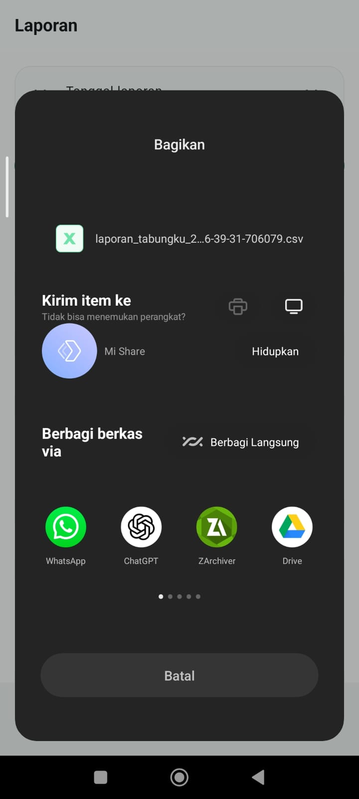

# TabungKu — Aplikasi Manajemen Kegiatan dan Keuangan

**TabungKu** adalah aplikasi mobile berbasis Flutter untuk membantu pengguna mengelola kegiatan harian sekaligus mencatat pemasukan dan pengeluaran. Aplikasi ini dikembangkan sebagai proyek tugas mata kuliah **Pemrograman Mobile — Pertemuan 7**.

TabungKu mengintegrasikan pengelolaan kegiatan, pencatatan transaksi, ringkasan keuangan, laporan berdasarkan tanggal, target tabungan, serta pengaturan tampilan yang disimpan secara lokal.

## Daftar Isi

- [Deskripsi Proyek](#deskripsi-proyek)
- [Tujuan](#tujuan)
- [Fitur Aplikasi](#fitur-aplikasi)
- [Teknologi yang Digunakan](#teknologi-yang-digunakan)
- [Struktur Folder](#struktur-folder)
- [Persyaratan Sistem](#persyaratan-sistem)
- [Cara Instalasi dan Menjalankan](#cara-instalasi-dan-menjalankan)
- [Cara Menggunakan Aplikasi](#cara-menggunakan-aplikasi)
- [Aturan Perhitungan Keuangan](#aturan-perhitungan-keuangan)
- [Pengujian Aplikasi](#pengujian-aplikasi)
- [Dokumentasi Screenshot](#dokumentasi-screenshot)
- [Kendala dan Penanganan](#kendala-dan-penanganan)
- [Pengembangan Selanjutnya](#pengembangan-selanjutnya)
- [Penutup](#penutup)

## Deskripsi Proyek

TabungKu merupakan aplikasi manajemen kegiatan dan keuangan yang menggabungkan dua kebutuhan dalam satu aplikasi. Pengguna dapat mencatat kegiatan, menentukan status penyelesaiannya, serta mencatat transaksi pemasukan dan pengeluaran.

Data kegiatan disimpan menggunakan SQLite sehingga tetap tersedia setelah aplikasi ditutup dan dibuka kembali. Sementara itu, pengaturan seperti mode tema, warna tema, dan target tabungan disimpan menggunakan SharedPreferences.

Aplikasi memiliki tiga tab utama, yaitu **Beranda**, **Laporan**, dan **Pengaturan**. Pengguna dapat berpindah antartab melalui navigasi bawah dan membuka formulir kegiatan melalui navigasi bernama.

## Tujuan

Pengembangan TabungKu bertujuan untuk:

1. Menerapkan konsep pengembangan aplikasi mobile menggunakan Flutter dan Dart.
2. Mengimplementasikan penggunaan widget untuk membangun antarmuka pengguna.
3. Menerapkan operasi tambah, baca, ubah, dan hapus data kegiatan.
4. Mengintegrasikan penyimpanan lokal menggunakan SQLite.
5. Mengimplementasikan validasi formulir dan pemilihan tanggal.
6. Mengolah data transaksi menjadi ringkasan keuangan dan laporan.
7. Menerapkan penyimpanan preferensi pengguna.
8. Menambahkan pencarian, filter, animasi progres, dan ekspor laporan sebagai fitur tambahan.

## Fitur Aplikasi

### 1. Manajemen Kegiatan

- Menambahkan kegiatan baru.
- Mengubah informasi kegiatan.
- Menghapus kegiatan dengan konfirmasi.
- Menandai kegiatan sebagai selesai atau belum selesai.
- Menampilkan daftar kegiatan berdasarkan tanggal.

### 2. Formulir dan Validasi

- Memasukkan judul kegiatan.
- Memilih tanggal kegiatan.
- Memilih jenis transaksi: kegiatan biasa, pemasukan, atau pengeluaran.
- Memasukkan nominal transaksi.
- Menentukan kategori kegiatan.
- Memvalidasi input sebelum data disimpan.

### 3. Penyimpanan SQLite

- Menyimpan data kegiatan secara lokal.
- Membaca data dari database.
- Memperbarui data kegiatan.
- Menghapus data kegiatan.
- Mempertahankan data setelah aplikasi ditutup dan dibuka kembali.

### 4. Ringkasan Keuangan

Halaman Beranda menampilkan:

- Total pemasukan hari ini.
- Total pengeluaran hari ini.
- Tabungan bersih hari ini.
- Jumlah kegiatan.
- Jumlah kegiatan yang belum selesai.

### 5. Laporan Keuangan

Halaman Laporan menyediakan:

- Pemilihan tanggal laporan.
- Ringkasan pemasukan dan pengeluaran.
- Perhitungan tabungan bersih.
- Rekap pengeluaran berdasarkan kategori.
- Rekap kegiatan dan transaksi selama tujuh hari yang berakhir pada tanggal pilihan.

### 6. Target Tabungan dan Animasi

- Menentukan target tabungan melalui halaman Pengaturan.
- Menampilkan persentase pencapaian target.
- Menampilkan indikator progres tabungan.
- Menggunakan animasi pada indikator progres.
- Menampilkan informasi ketika target tercapai.

### 7. Pengaturan Tampilan

- Mengaktifkan mode terang.
- Mengaktifkan mode gelap.
- Memilih warna tema.
- Menentukan target tabungan.
- Menyimpan preferensi menggunakan SharedPreferences.

### 8. Navigasi Aplikasi

TabungKu memiliki tiga tab utama:

- **Beranda:** ringkasan keuangan dan daftar kegiatan.
- **Laporan:** ringkasan transaksi, pengeluaran per kategori, dan rekap tujuh hari.
- **Pengaturan:** tema, warna, dan target tabungan.

Formulir tambah dan ubah kegiatan diakses melalui named route.

### 9. Fitur Tambahan

Selain fitur utama, TabungKu menyediakan beberapa fitur tambahan berikut.

| Fitur | Deskripsi |
|---|---|
| Pencarian kegiatan | Mencari kegiatan berdasarkan judul atau kategori. |
| Filter status | Menampilkan semua kegiatan, kegiatan belum selesai, atau kegiatan selesai. |
| Kombinasi pencarian dan filter | Memungkinkan pencarian dan penyaringan status digunakan bersamaan. |
| Ekspor laporan CSV | Menghasilkan file CSV dari data kegiatan pada periode laporan tujuh hari dan membuka menu berbagi. |
| Tema dinamis | Memungkinkan pengguna mengganti mode terang/gelap dan warna tema. |
| Animasi progres tabungan | Memberikan visualisasi pencapaian target tabungan. |

**Catatan:** pencarian pada Beranda menyaring kegiatan yang ditampilkan untuk tanggal hari ini. Ekspor CSV mengambil kegiatan dari tujuh tanggal kalender yang berakhir pada tanggal laporan yang dipilih.

## Teknologi yang Digunakan

| Teknologi atau package | Kegunaan |
|---|---|
| Flutter | Framework pengembangan aplikasi mobile. |
| Dart | Bahasa pemrograman aplikasi. |
| Material 3 | Sistem desain antarmuka. |
| SQLite | Penyimpanan data kegiatan secara lokal. |
| `sqflite` | Integrasi database SQLite pada Flutter. |
| `path` | Membantu pengelolaan path database. |
| `shared_preferences` | Penyimpanan preferensi pengguna. |
| `csv` | Dependensi yang ditambahkan saat pengembangan ekspor CSV; implementasi konversi CSV saat ini menggunakan fungsi lokal. |
| `path_provider` | Mendapatkan direktori sementara untuk file ekspor. |
| `share_plus` | Membagikan file CSV melalui menu berbagi perangkat. |

## Struktur Folder

Struktur utama proyek:

```text
tabungku/
├── lib/
│   ├── main.dart
│   ├── data/
│   │   └── db_helper.dart
│   ├── models/
│   │   └── kegiatan.dart
│   ├── pages/
│   │   ├── shell_page.dart
│   │   ├── beranda_page.dart
│   │   ├── form_kegiatan_page.dart
│   │   ├── laporan_page.dart
│   │   └── pengaturan_page.dart
│   ├── state/
│   │   └── pengaturan.dart
│   └── utils/
│       ├── format.dart
│       └── ekspor_laporan.dart
├── test/
│   └── widget_test.dart
├── screenshots/
│   ├── beranda.png
│   ├── form-kegiatan.png
│   ├── laporan.png
│   ├── pengaturan.png
│   ├── pencarian-filter.png
│   └── ekspor-csv.png
├── android/
├── ios/
├── linux/
├── macos/
├── web/
├── windows/
├── pubspec.yaml
├── pubspec.lock
└── README.md
```

Struktur di atas merupakan gambaran file utama. Folder platform dapat berbeda sesuai target platform yang dibuat ketika proyek Flutter diinisialisasi. Folder `screenshots/` digunakan untuk menyimpan dokumentasi visual aplikasi.

## Persyaratan Sistem

Sebelum menjalankan proyek, pastikan perangkat pengembangan memiliki:

- Flutter SDK yang sudah terpasang.
- Dart SDK yang sesuai dengan versi Flutter.
- Android Studio atau perangkat Android yang dapat digunakan untuk pengujian, atau target platform Flutter lainnya.
- Visual Studio Code atau editor kode lainnya.
- Git untuk pengelolaan versi, jika diperlukan.

Periksa instalasi Flutter dengan:

```bash
flutter doctor -v
```

## Cara Instalasi dan Menjalankan

### 1. Clone repository

Jika repository sudah diunggah ke GitHub, clone repository menggunakan:

```bash
git clone https://github.com/illhammf/pemrograman-mobile.git
```

Masuk ke folder proyek TabungKu:

```bash
cd pemrograman-mobile/pertemuan-7/tugas/tabungku
```

Jika repository sudah ada di komputer, cukup masuk ke folder proyek yang sesuai.

### 2. Instal dependensi

Jalankan:

```bash
flutter pub get
```

Perintah ini mengunduh dependensi yang tercantum dalam `pubspec.yaml`.

### 3. Periksa konfigurasi Flutter

```bash
flutter doctor -v
```

Pastikan toolchain untuk platform yang akan digunakan sudah siap.

### 4. Periksa kode aplikasi

```bash
dart format lib test
flutter analyze
```

### 5. Jalankan pengujian otomatis

```bash
flutter test
```

### 6. Jalankan aplikasi

Pastikan emulator atau perangkat tujuan sudah tersedia, kemudian jalankan:

```bash
flutter devices
flutter run
```

Jika ada beberapa perangkat, pilih perangkat tujuan sesuai daftar yang ditampilkan Flutter.

### 7. Menjalankan kembali setelah laptop dimatikan

Jika laptop sudah dimatikan atau terminal sebelumnya ditutup, lakukan langkah berikut:

1. Nyalakan kembali laptop.
2. Buka terminal.
3. Pastikan Flutter tersedia dengan menjalankan `flutter --version`.
4. Masuk ke folder proyek `tabungku`.
5. Jalankan `flutter pub get` jika dependensi perlu dipulihkan.
6. Nyalakan emulator atau hubungkan perangkat.
7. Jalankan `flutter run`.

Data kegiatan tersimpan pada database lokal aplikasi di perangkat. Data tersebut tidak otomatis tersimpan ke GitHub karena database aplikasi merupakan data runtime, bukan bagian dari source code yang di-commit.

## Cara Menggunakan Aplikasi

### 1. Menambahkan kegiatan

1. Buka tab Beranda.
2. Tekan tombol tambah.
3. Masukkan judul kegiatan.
4. Pilih tanggal.
5. Tentukan jenis kegiatan atau transaksi.
6. Masukkan nominal jika diperlukan.
7. Pilih kategori.
8. Simpan kegiatan.

### 2. Mengelola kegiatan

- Gunakan checkbox untuk mengubah status kegiatan.
- Buka menu pada kartu kegiatan untuk mengubah atau menghapusnya.
- Konfirmasi penghapusan ketika dialog ditampilkan.

### 3. Mencari dan memfilter kegiatan

1. Buka tab Beranda.
2. Masukkan judul atau kategori pada kolom pencarian.
3. Pilih filter status.
4. Gunakan tombol hapus pencarian atau reset jika ingin kembali ke daftar awal.

### 4. Melihat laporan keuangan

1. Buka tab Laporan.
2. Pilih tanggal yang ingin dijadikan tanggal akhir laporan.
3. Periksa ringkasan pemasukan, pengeluaran, dan tabungan bersih.
4. Periksa pengeluaran per kategori.
5. Periksa rekap tujuh hari.

### 5. Mengekspor laporan

1. Buka tab Laporan.
2. Pilih tanggal laporan.
3. Tekan tombol **Ekspor Laporan ke CSV**.
4. Tunggu proses pembuatan file.
5. Pilih aplikasi tujuan pada menu berbagi.
6. Simpan atau kirim file sesuai kebutuhan.

### 6. Mengatur target tabungan dan tema

1. Buka tab Pengaturan.
2. Pilih mode terang atau gelap.
3. Pilih warna tema.
4. Atur target tabungan.
5. Kembali ke Beranda untuk melihat progres tabungan.

## Aturan Perhitungan Keuangan

TabungKu mengelompokkan data transaksi berdasarkan jenisnya.

- **Pemasukan:** nominal transaksi yang bertipe pemasukan.
- **Pengeluaran:** nominal transaksi yang bertipe pengeluaran.
- **Tabungan bersih:** total pemasukan dikurangi total pengeluaran.
- **Kegiatan biasa:** tidak menambah pemasukan atau pengeluaran.
- **Status kegiatan:** status selesai atau belum selesai tidak mengubah nilai tabungan bersih.

Perhitungan tabungan bersih mengikuti transaksi pada tanggal yang dipilih. Status penyelesaian kegiatan tidak menjadi syarat untuk menghitung transaksi.

## Pengujian Aplikasi

Pengujian fungsional dilakukan secara manual dengan menjalankan aplikasi dan memeriksa perilaku fitur. Seluruh 12 skenario berikut telah dinyatakan lulus berdasarkan hasil pengujian manual.

| No. | Skenario pengujian | Hasil |
|---:|---|---|
| 1 | Menambah kegiatan | Lulus |
| 2 | Validasi formulir | Lulus |
| 3 | Mengubah dan menghapus kegiatan | Lulus |
| 4 | Mengubah status kegiatan | Lulus |
| 5 | Pencarian dan filter | Lulus |
| 6 | Ringkasan keuangan | Lulus |
| 7 | Laporan keuangan | Lulus |
| 8 | Ekspor CSV | Lulus |
| 9 | Target tabungan | Lulus |
| 10 | Penyimpanan tema | Lulus |
| 11 | Persistensi data SQLite | Lulus |
| 12 | Navigasi aplikasi | Lulus |

**Ringkasan pengujian manual: 12 dari 12 skenario dinyatakan lulus.**

Hasil tersebut merupakan hasil pengujian fungsional manual. Pemeriksaan otomatis melalui `flutter test` dan analisis kode melalui `flutter analyze` merupakan pemeriksaan terpisah dan perlu dijalankan kembali pada versi kode final.


## Dokumentasi Screenshot

Berikut merupakan dokumentasi antarmuka aplikasi TabungKu.

<table>
  <tr>
    <td align="center" width="33%">
      <strong>1. Beranda</strong><br><br>
      <br>
      <sub>Ringkasan keuangan dan daftar kegiatan.</sub>
    </td>
    <td align="center" width="33%">
      <strong>2. Formulir Kegiatan</strong><br><br>
      <br>
      <sub>Formulir tambah dan ubah kegiatan.</sub>
    </td>
    <td align="center" width="33%">
      <strong>3. Pencarian dan Filter</strong><br><br>
      <br>
      <sub>Pencarian judul dan kategori serta filter status.</sub>
    </td>
  </tr>
  <tr>
    <td align="center" width="33%">
      <strong>4. Laporan Keuangan</strong><br><br>
      <br>
      <sub>Ringkasan keuangan dan rekap tujuh hari.</sub>
    </td>
    <td align="center" width="33%">
      <strong>5. Pengaturan</strong><br><br>
      <br>
      <sub>Pengaturan tema dan target tabungan.</sub>
    </td>
    <td align="center" width="33%">
      <strong>6. Ekspor CSV</strong><br><br>
      <br>
      <sub>Proses ekspor dan berbagi laporan CSV.</sub>
    </td>
  </tr>
</table>

## Kendala dan Penanganan

### 1. Validasi input

Formulir perlu memvalidasi data sebelum penyimpanan untuk mencegah input yang tidak sesuai, seperti judul kosong atau nominal transaksi yang tidak valid.

### 2. Persistensi data

SQLite digunakan agar data kegiatan tetap tersedia setelah aplikasi ditutup. SharedPreferences digunakan untuk menyimpan preferensi pengguna.

### 3. Konversi CSV

Implementasi ekspor menggunakan fungsi konversi lokal untuk mengubah baris data menjadi teks CSV, termasuk penanganan tanda kutip dan pemisah di dalam teks.

### 4. Izin file pada lingkungan pengembangan

Jika proses pemformatan file mengalami `Permission denied`, periksa kepemilikan dan izin tulis file pada sistem operasi sebelum menjalankan kembali formatter.

### 5. Pemeriksaan kualitas kode

Jalankan `dart format`, `flutter analyze`, dan `flutter test` untuk membantu menjaga format kode serta menemukan masalah sebelum proyek diserahkan.

## Pengembangan Selanjutnya

Beberapa kemungkinan pengembangan TabungKu pada masa mendatang:

- Menambahkan grafik pemasukan dan pengeluaran.
- Menyediakan ekspor laporan dalam format PDF.
- Menambahkan pencadangan dan pemulihan database.
- Menambahkan pengingat kegiatan.
- Menyediakan pencarian untuk seluruh riwayat kegiatan, bukan hanya daftar hari ini.
- Menambahkan pengujian otomatis untuk operasi database dan validasi formulir.

Fitur-fitur tersebut merupakan usulan pengembangan, bukan klaim bahwa semuanya sudah tersedia pada versi saat ini.

## Penutup

TabungKu merupakan implementasi aplikasi mobile yang menggabungkan manajemen kegiatan dan pencatatan keuangan dalam satu aplikasi. Proyek ini menerapkan Flutter, Dart, SQLite, SharedPreferences, navigasi, validasi formulir, pengolahan laporan, serta ekspor CSV.

Berdasarkan pengujian manual yang dilakukan, seluruh 12 skenario fungsional yang dicantumkan telah dinyatakan lulus. README ini menjadi dokumentasi penggunaan, fitur, struktur proyek, dan pengujian untuk mendukung proses evaluasi proyek **Pemrograman Mobile — Pertemuan 7**.
